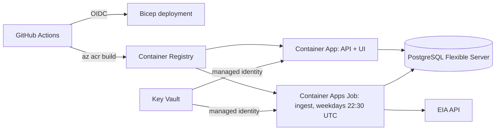

# Deploying to Azure

The app runs on **Azure Container Apps**. One container serves both the FastAPI API and the React build, and it connects to **Azure Database for PostgreSQL – Flexible Server**. A scheduled **Container Apps Job** runs the ingestion pipeline. Secrets live in **Key Vault** and are read through a **managed identity**. **GitHub Actions** deploys everything with OIDC, so no Azure credentials are stored in GitHub, and **Bicep** defines the infrastructure as code (`infra/main.bicep`).



## One-time setup (about 15 minutes)

You need the [Azure CLI](https://learn.microsoft.com/cli/azure/install-azure-cli), a personal Azure subscription, and the GitHub repo already pushed.

### 1. Sign in and register the resource providers

```bash
az login
az account set --subscription "<your subscription name or id>"

for ns in Microsoft.App Microsoft.OperationalInsights Microsoft.ContainerRegistry \
          Microsoft.KeyVault Microsoft.DBforPostgreSQL Microsoft.ManagedIdentity; do
  az provider register --namespace $ns
done
```

### 2. Create the resource group

```bash
RG=rg-energy-dashboard
LOCATION=southcentralus   # San Antonio; any region with Container Apps and PostgreSQL works
az group create -n $RG -l $LOCATION
```

### 3. Let GitHub deploy with OIDC (no secrets stored)

Replace `<github-user>` with your GitHub username.

```bash
REPO=<github-user>/energy-market-dashboard
SUB=$(az account show --query id -o tsv)
TENANT=$(az account show --query tenantId -o tsv)

APP_ID=$(az ad app create --display-name gh-energy-dashboard --query appId -o tsv)
az ad sp create --id $APP_ID

az ad app federated-credential create --id $APP_ID --parameters "{
  \"name\": \"github-production\",
  \"issuer\": \"https://token.actions.githubusercontent.com\",
  \"subject\": \"repo:$REPO:environment:production\",
  \"audiences\": [\"api://AzureADTokenExchange\"]
}"

# Owner on this resource group only: the template creates role assignments
# (AcrPull and Key Vault Secrets User) for the app's managed identity.
az role assignment create --assignee $APP_ID --role Owner \
  --scope /subscriptions/$SUB/resourceGroups/$RG

echo "AZURE_CLIENT_ID=$APP_ID  AZURE_TENANT_ID=$TENANT  AZURE_SUBSCRIPTION_ID=$SUB"
```

### 4. Add GitHub secrets and variables

In the repo, go to **Settings → Secrets and variables → Actions**, or use the `gh` CLI:

```bash
gh secret set AZURE_CLIENT_ID --body "$APP_ID"
gh secret set AZURE_TENANT_ID --body "$TENANT"
gh secret set AZURE_SUBSCRIPTION_ID --body "$SUB"
gh secret set POSTGRES_ADMIN_PASSWORD     # 8+ chars; at least 3 of: upper, lower, digit, symbol
gh secret set EIA_API_KEY                 # free: https://www.eia.gov/opendata/register.php

gh variable set AZURE_RESOURCE_GROUP --body "$RG"
gh variable set AZURE_LOCATION --body "$LOCATION"
```

### 5. Deploy

Go to **Actions → Deploy to Azure → Run workflow**. The first run takes about 10–15 minutes, mostly creating the PostgreSQL server. When it finishes, the run summary shows the app URL, which looks like `https://emd-web.<id>.southcentralus.azurecontainerapps.io`.

To deploy automatically after every green CI run on `main`, set:

```bash
gh variable set AZURE_DEPLOY_ENABLED --body true
```

## What the deployment creates

| Resource | Purpose |
|---|---|
| Container App `emd-web` | API + UI, HTTPS, scales to zero when idle |
| Container Apps Job `emd-ingest` | Runs `python -m app.pipeline` on a cron schedule (`ingestCron` parameter) |
| PostgreSQL Flexible Server (Burstable B1ms) | Database, TLS required |
| Key Vault | `database-url` and `eia-api-key` secrets |
| User-assigned managed identity | Pulls images from the registry and reads Key Vault secrets |
| Container Registry (Basic) | Images, built in Azure with `az acr build` |
| Log Analytics workspace | Container logs, 30-day retention |

## Cost control

- **Main cost: the PostgreSQL server.** The Burstable B1ms tier is the smallest. Container Apps scale to zero, so the web app costs little at demo traffic. Container Registry Basic and Key Vault add small monthly amounts. Check the [Azure pricing calculator](https://azure.microsoft.com/pricing/calculator/) for current prices in your region.
- **Set a budget alert:** in the Azure portal, open **Cost Management → Budgets** and create one, for example $25/month with an email alert.
- **Pause the database** while you're not job hunting. Azure restarts a stopped server automatically after 7 days.
  ```bash
  az postgres flexible-server stop -g $RG -n <server-name>
  ```
- **Remove everything** with `az group delete -n $RG`. Key Vault keeps deleted vaults for 7 days. To redeploy within that window, purge the vault with `az keyvault purge -n <vault-name>`.

## Troubleshooting

- **The PostgreSQL deployment fails with a location or quota error.** Some new or free-trial subscriptions restrict PostgreSQL in certain regions. Set `AZURE_LOCATION` to another region, such as `centralus` or `eastus2`, and re-run.
- **The app shows "Sample data (simulated)".** `EIA_API_KEY` wasn't set when you deployed. Add the secret and re-run the workflow.
- **Check logs:**
  - App: `az containerapp logs show -g $RG -n emd-web --follow`
  - Job runs: `az containerapp job execution list -g $RG -n emd-ingest -o table`
- **The first page load is slow.** With `minReplicas=0`, the first request after idle starts a container, which takes a few seconds. Set `minReplicas=1` in the workflow to keep one replica warm, which costs more.
